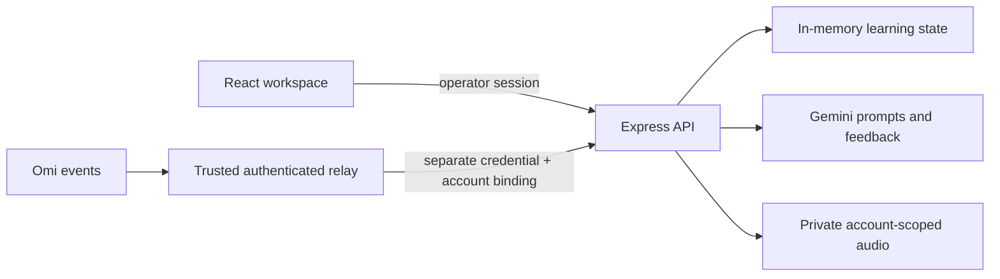

# Omi LinguaLearn

Built for DevHouse, LinguaLearn turns Omi conversation memories into language practice grounded in your own life. It creates personalized speaking challenges, uses Gemini to give feedback, and saves corrections for spaced-repetition review.

## Preview

The screenshots show the seeded demo workspace. Omi is disconnected, and AI feedback remains unassessed until the integrations are configured.


| Dashboard | Progress |
| --- | --- |
|  |  |

## Try the demo

Requires Node.js 22.12 or newer and npm. No Omi account or Google credentials are needed for the seeded workspace.

```sh
npm ci
cp .env.example .env
openssl rand -hex 32
```

Paste the generated value into `APP_ACCESS_TOKEN` in `.env`, then run:

```sh
npm run dev
```

Open `http://localhost:5000` and sign in with the same token. You can explore the dashboard, seeded challenges, learning queue, and progress. Live Omi ingestion and Gemini features require [additional setup](docs/self-hosting.md).

If port 5000 is occupied, change both `PORT` and `PUBLIC_ORIGIN` in `.env` to the same new port. The browser URL must exactly match `PUBLIC_ORIGIN`, including `localhost` versus `127.0.0.1`.

## What it does

- React dashboard with speaking challenges, a learning queue, language settings, and progress from recorded activity.
- Express API for personal memories, challenge responses, coach chat, and SM-2 review scheduling.
- Gemini generates prompts and feedback. Failed analysis does not award a score; pronunciation is unavailable when no audio is analyzed.
- Optional PCM16 ingestion and WAV storage in Google Cloud Storage, scoped to one configured Omi account.

## Setup and limitations

This is a self-hosted, single-operator portfolio prototype, not a multi-user hosted service or Omi App Store release. Data and sessions live in memory and disappear on restart. The Drizzle schema describes a future persistence layer; PostgreSQL is not connected to the runtime. Omi ingestion is disabled without a trusted authenticated relay; Gemini and cloud audio are optional. See [self-hosting, webhook, and privacy details](docs/self-hosting.md) before connecting real data or deploying remotely.

Run `npm run check`, `npm test`, and `npm run build` to verify changes. Run `npm start` after building to serve the production bundle.

## Architecture



Core code: `server/security.ts` (request boundary), `server/audio-ingestion.ts` (bounded PCM pipeline), `server/gcp-storage.ts` (cloud object access), `server/gemini-challenge.ts` (feedback), and `server/storage.ts` (practice scheduling).

## License

MIT. See [LICENSE](LICENSE).
