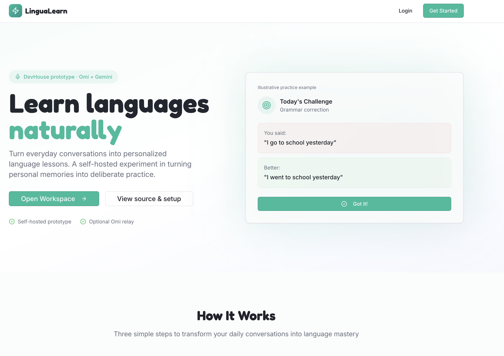
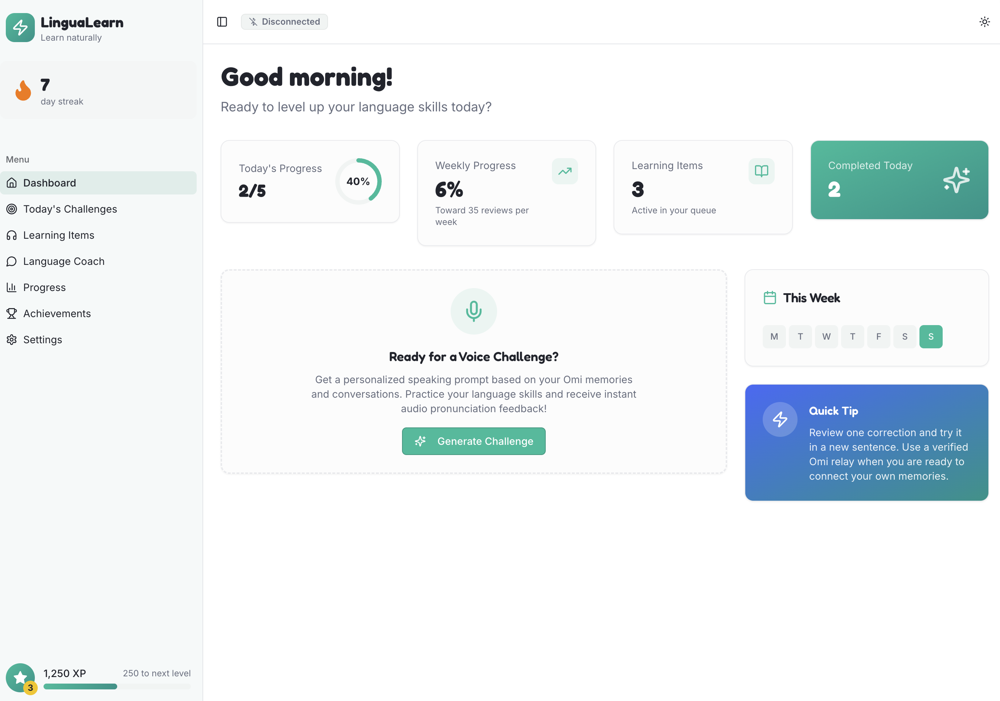
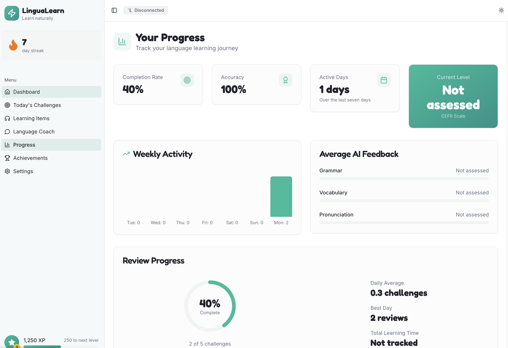
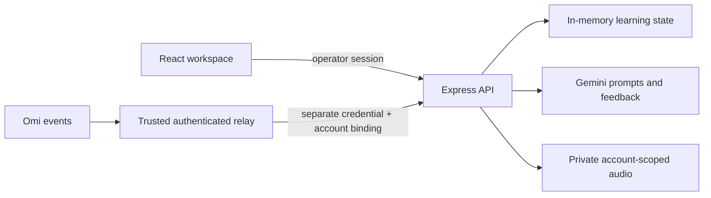

# Omi LinguaLearn

A language-learning prototype built for DevHouse: turn Omi conversation memories into personalized speaking challenges, Gemini feedback, and a spaced-repetition practice queue.

The interesting engineering work is the connection between everyday conversation and deliberate practice: ingest a memory, extract a useful fact, generate a prompt in the learner's target language, then turn feedback into something to review later.

## Preview

The screenshots show the seeded demo workspace. Omi is disconnected, and AI feedback remains unassessed until the integrations are configured.



| Dashboard | Progress |
| --- | --- |
|  |  |

## What it does

- React dashboard with speaking challenges, a learning queue, language settings, and progress from recorded activity.
- Express API for personal memories, challenge responses, coach chat, and SM-2 review scheduling.
- Gemini generates prompts and feedback. Failed analysis does not award a score; pronunciation is unavailable when no audio is analyzed.
- Optional PCM16 ingestion and WAV storage in Google Cloud Storage, scoped to one configured Omi account.

**Status: self-hosted, single-operator portfolio prototype.** Application data and sessions live in memory and disappear on restart. The Drizzle schema describes a future persistence layer; PostgreSQL is not connected to the runtime. This is not a multi-user hosted service or an Omi App Store release.

## Run locally

Requires Node.js 22.12 or newer and npm.

```sh
npm ci
cp .env.example .env
openssl rand -hex 32
```

Paste the generated value into `APP_ACCESS_TOKEN` in `.env`, then run:

```sh
npm run dev
```

Open `http://localhost:5000` and sign in with that access token. Keep the URL aligned with `PUBLIC_ORIGIN`; `localhost` and `127.0.0.1` are different origins. Scripts load `.env` automatically. With no `OMI_UID`, the operator sees explicitly seeded demo data. A configured `OMI_UID` creates a separate workspace with demo facts disabled by default.

```sh
npm run check
npm test
npm run build
npm start
```

For remote self-hosting, set `PUBLIC_ORIGIN` to your exact HTTPS origin and `HOST=0.0.0.0` behind a TLS reverse proxy. Configure proxy request/time limits too. Start fails closed without a strong `APP_ACCESS_TOKEN`. No secrets belong in client environment variables or Git.

## Optional integrations

| Variable | Purpose |
| --- | --- |
| `GEMINI_API_KEY` | Server-side Google Gemini credential; required for feedback and coach chat |
| `GEMINI_MODEL` | Model override; defaults to `gemini-2.5-flash` |
| `OMI_UID` | The single allowed Omi account, 20–128 alphanumeric characters |
| `OMI_WEBHOOK_SECRET` | Separate random secret of at least 32 characters for authenticated relay delivery |
| `GCP_BUCKET_NAME` | Private application audio bucket |
| `GCP_SERVICE_ACCOUNT_JSON` | Server-side service account JSON with access restricted to that bucket |

### Webhook relay contract

Ingestion is **disabled** until both `OMI_UID` and `OMI_WEBHOOK_SECRET` are configured. Native Omi support for sending these authentication headers has not been verified. Use a trusted relay that verifies Omi's upstream delivery and adds the credentials below, or leave ingestion disabled. An unverified public relay would defeat this boundary.

Only these POST routes accept relay authentication:

- `/api/omi/hub` (event auto-detection, or `event=memory|transcript|audio|setup_complete`)
- `/api/omi/webhook/memory`, `/api/omi/webhook/transcript`, `/api/omi/webhook/audio`
- `/api/omi/setup-complete`

Each callback must include:

- Query `uid` matching the configured account; optional `session_id` with 1–128 letters, digits, underscores, or hyphens.
- `Authorization: Bearer <OMI_WEBHOOK_SECRET>`.
- `X-Event-Id`: a unique 16–128 character event ID (UUIDs work).
- `X-Event-Timestamp`: current Unix time in milliseconds, within five minutes.

IDs are retained for ten minutes to reject duplicate delivery. Retries of a rejected or failed request need a new event ID; the relay must determine whether an operation completed before retrying. This prototype does not provide durable exactly-once processing. Public Omi chat tools are disabled; their internal routes require an operator session.

JSON is limited to 64 KiB; PCM requests to 2 MiB. PCM must be mono, 16-bit, even byte length, at 8/16/24/48 kHz. At most four API requests run concurrently. The hub buffers up to eight sessions / 16 MiB with a five-minute idle expiry and uploads minute-long WAV segments. Partial final minutes are not flushed and can expire. Failed uploads retain the pending minute in the bounded pool until a later attempt succeeds or the idle timeout expires. Direct audio callbacks store up to eight chunks per session for manual compilation. Cloud reads are restricted to the configured bucket and account prefix, with a 6 MiB per-object and eight-object analysis limit.

## Privacy and limitations

- Browser sign-in exchanges the operator token for an HttpOnly, SameSite=Strict session cookie with a 12-hour lifetime. Remote cookies require HTTPS. Logout cancels queries and clears cached private data.
- User identifiers supplied by clients do not grant access. Numeric records are checked against the authenticated owner.
- Audio, transcripts and memories can contain other people's speech. Only ingest material you have permission to process. Relevant text/audio is sent to Google when AI features run; recordings remain in your private GCS bucket.
- API responses, transcripts, account identifiers and credentials are not logged by the application. Review your reverse proxy and hosting log settings separately.
- Reset clears local learning and audio metadata. It does **not** delete GCS recordings or provider-held data; delete recordings separately and configure a bucket lifecycle policy.
- Gemini scores are model-generated practice feedback, not a validated language proficiency assessment. CEFR is shown as unassessed.
- No live Omi, Gemini, GCS or hosting deployment was exercised by the offline regression suite. Durable storage, production identity management, persistent replay protection, a reliable queue, and end-to-end provider tests remain future work.

## Architecture



Core code: `server/security.ts` (request boundary), `server/audio-ingestion.ts` (bounded PCM pipeline), `server/gcp-storage.ts` (cloud object access), `server/gemini-challenge.ts` (feedback), and `server/storage.ts` (practice scheduling).

## License

MIT. See [LICENSE](LICENSE).
